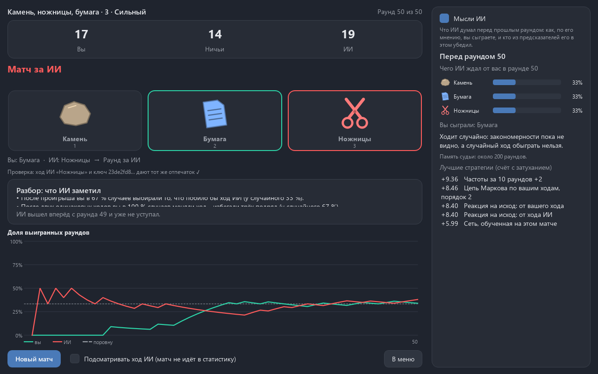
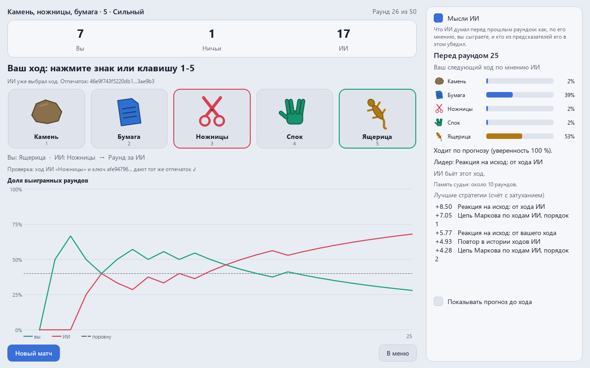

<div align="center">

# Камень, ножницы, бумага против ИИ

**Камень-ножницы-бумага (и вариант с ящерицей и Споком) против ИИ, который по ходу матча замечает ваши привычки. Ход ИИ закрыт отпечатком до того, как вы выберете, и после каждого раунда видно, что он не подглядывал.**

[English version](README.md)

[](LICENSE)



</div>

Человек не умеет быть случайным. Он повторяется, избегает трёх одинаковых подряд, после
проигрыша меняет ход. ИИ это ловит и примерно через 30 раундов начинает выигрывать чаще, чем
проигрывать. Честно случайного игрока он обыграть не может, и это тоже проверяется тестами.

## Что есть

- **3 знака** или **5 знаков** (камень, бумага, ножницы, Спок, ящерица).
- Матч на **50** или **100** раундов или **без конца** с кнопкой «Завершить матч».
- Уровни **новичок**, **средний**, **сильный** и режим **«ИИ против бота»**: ИИ играет с ботом с
  привычкой, а вы смотрите, как он её ловит.
- **Ход под отпечатком**: до вашего хода в окне виден отпечаток SHA-256 выбора ИИ, после раунда
  раскрываются ход и ключ, и отпечаток сверяется.
- **«Мысли ИИ»**: как ИИ ждал вашего хода в прошлом раунде, какой предсказатель лидировал и почему,
  лучшие стратегии. До хода виден только отпечаток; флажок «Подсматривать ход ИИ (матч не идёт в
  статистику)» показывает ход, который ИИ уже выбрал, и его прогноз, а матч помечается и в
  статистику не идёт.
- **Разбор после матча**: какие привычки ИИ нашёл, например «после проигрыша вы в 67 % случаев
  выбирали то, что побило бы ход ИИ (у случайного 33 %)», и с какого раунда ИИ уже не уступал.
- График выигранных раундов; статистика с графиками: доля выигранных раундов по матчам, раунды
  по уровням и сила ИИ из паспорта столбиками. Темы Paint (тёмная и светлая), русский и английский, звуки,
  окно открывается там, где его закрыли. Знаки нарисованы кодом, без картинок и эмодзи.



## Как играет ИИ

1. **Предсказатели** угадывают ваш следующий ход по истории прошлых раундов:
   - частоты за весь матч и за последние 10 и 30 раундов;
   - цепи Маркова порядков 1-5 по вашим ходам, 1-3 по ходам ИИ и по парам ходов;
   - реакция на исход: что вы делаете после победы, ничьей и поражения - от своего хода и от хода ИИ;
   - поиск по истории, как в боте Iocaine Powder: самый длинный кусок истории, который повторяет её конец;
   - маленькая сеть на numpy (3 раунда на входе, 24 нейрона, softmax), которая учится **по ходу матча**.
2. **Сдвиги**: у каждого предсказателя есть версии «вы на шаг хитрее» и «на два шага».
3. **Судьи** с разной памятью (около 3, 10, 33 и 200 раундов) ведут счёт каждой стратегии с
   затуханием; ИИ верит тому судье, чей собственный выбор в последнее время работал лучше.
4. **Уверенность**: если явного преимущества нет, ИИ ходит случайно - случайный ход обыграть нельзя.
5. **Защита**: если ИИ проигрывает по своим же прогнозам, его раскусили, и он 20 раундов ходит случайно
   (при повторе срок удваивается).

| Уровень | Предсказатели |
|---|---|
| Новичок | только частоты, без сдвигов и защиты |
| Средний | частоты и цепи Маркова по вашим ходам |
| Сильный | всё перечисленное |

## Паспорт

`game/models/rockpaper-passport.json`, `python -m game.train.passport`: 40 матчей по 100 раундов на
каждую проверку, 216 с на 2 процессах. Доля раундов, выигранных / проигранных сильным ИИ **после
30-го раунда**:

| Соперник | 3 знака | 5 знаков |
|---|---|---|
| Повторяет (в 80 % случаев) | 82,8 % / 7,6 % | 86,1 % / 8,9 % |
| Цикл камень → ножницы → бумага | 100 % / 0 % | 100 % / 0 % |
| Выиграл - остался, проиграл - сменил | 99,8 % / 0,1 % | 100 % / 0 % |
| Маркова 2 (любимый ход после каждой пары, 75 %) | 75,4 % / 10,7 % | 69,6 % / 19,0 % |
| Любит камень (50/30/20) | 38,0 % / 28,9 % | 41,9 % / 37,7 % |
| Как человек (без трёх подряд, привычки наполовину) | 43,8 % / 27,8 % | 46,8 % / 34,8 % |
| Случайный | 33,8 % / 33,8 % | 41,4 % / 39,0 % |
| Зеркало (сам предсказывает ИИ и бьёт) | 41,7 % / 30,4 % | 46,6 % / 35,5 % |
| Копия того же ИИ (худший случай) | 32,8 % / 34,2 % | 38,1 % / 42,7 % |

На пяти знаках поровну - это 40 % побед, 20 % ничьих и 40 % поражений.

**Против случайного игрока** (5 матчей по 4000 раундов): 33,6 / 33,4 / 33,0 % на трёх знаках и
40,1 / 19,8 / 40,1 % на пяти. Даже если бы человек задним числом знал полные таблицы «после таких
0-2 ходов ИИ следующий распределён так», он выигрывал бы за раунд не больше чем на 2,4 % больше,
чем против честного генератора той же длины.

Тесты пересчитывают первый матч каждой проверки с теми же зёрнами и проверяют заявленное выше.

## Честность

- `tests/test_honesty.py`: при той же истории и том же зерне ход ИИ в раунде t один и тот же, что
  бы вы ни сыграли в раунде t; ИИ получает только кортеж прошлых раундов.
- Отпечаток каждого раунда сверяется в окне и в самопроверке.
- «Мысли ИИ» показывают прошлый раунд. Текущий прогноз - только с флажком «подглядывать», и тогда матч
  не идёт в статистику.

## Скачать

Готовые сборки для Windows (установщик и portable-архив) - в [выпусках](../../releases). Сборки без подписи кода, SmartScreen может предупредить при первом запуске.

## Запуск

```
pip install -r requirements.txt
python main.py
python main.py --selftest итог.txt    # без экрана: правила, ИИ против ботов, матч через окно
```

Клавиши: 1-5 - знак, N - новый матч, Esc - меню, пробел - пауза показа «ИИ против бота».

## Проверки

```
pip install -r requirements-dev.txt
python -m pytest -q
python tools/mutate.py          # мутационная проверка: нарочно сломанный код должен валить тесты
python tools/make_previews.py   # кадры в docs/
```

Тесты окна идут без экрана (Qt offscreen).

## Устройство

`game/` устроена по контракту ИИ-Игротеки (`GAME_INFO` и `create_widget(ctx)`): `core/` - правила,
ход под отпечатком и матч без Qt, `ai/` - предсказатели, сеть, мета-выбор, боты, разбор привычек,
`train/passport.py` - паспорт, `ui/` - окно. `aikit/` - общий набор игр с ИИ.

## Лицензия

MIT, см. [LICENSE](LICENSE).
